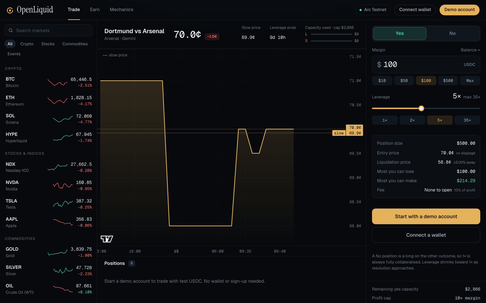
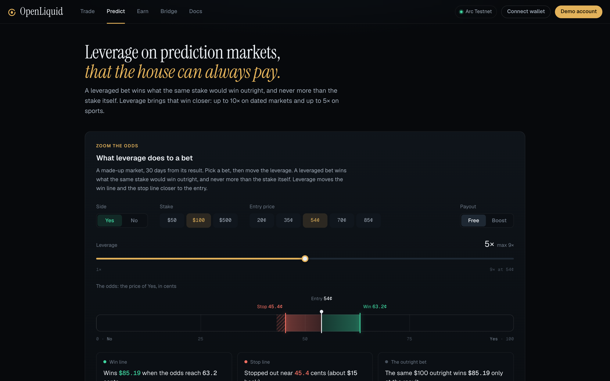
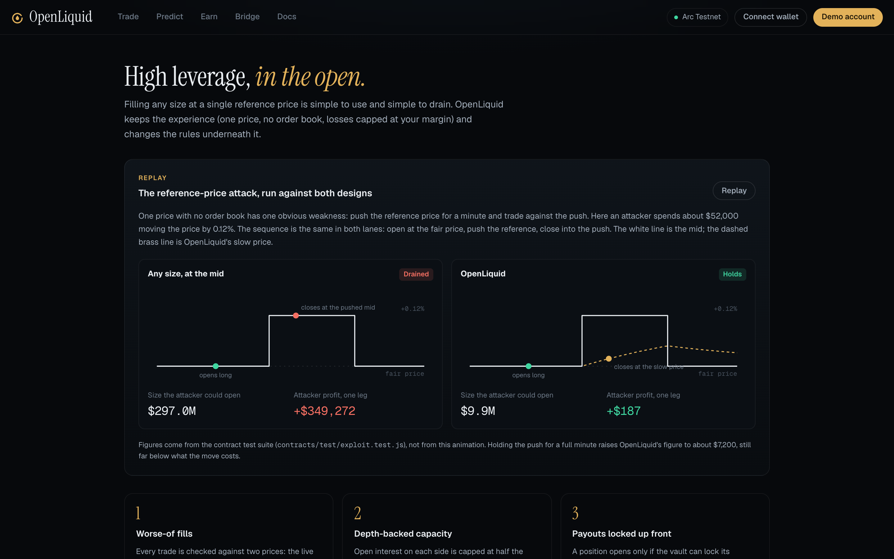
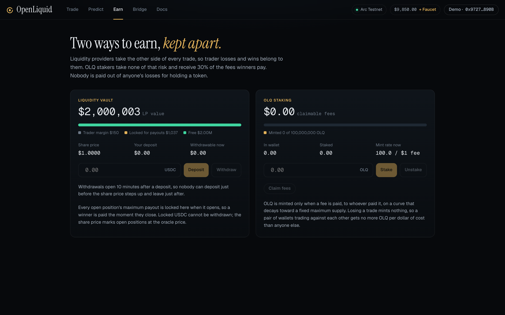

# OpenLiquid

**Trade anything with a price, at one price. No order book and no slippage in a calm market, up
to 1000× on crypto, stocks and commodities, and leverage on live prediction markets. On Arc.**
A winner is always paid in full when they close.


| | |
|---|---|
| **Hackathon** | University Blockchain Conference 2026 |
| **Main track** | DeFi and Onchain Applications |
| **Chain award** | Best use of Arc |
| **Bounty** | Gemini Prediction Markets |
| **Circle tools** | CCTP V2 with the Forwarding Service, for USDC in and out of Arc ([details](#circle-tools)) |
| **Live app** | **[pramay2007.github.io/OpenLiquid](https://pramay2007.github.io/OpenLiquid/)**: open it, click **Demo account**, and trade. No wallet needed. |
| **Whitepaper** | [docs/whitepaper](docs/whitepaper/README.md), also readable inside the app |
| **Status** | Live and tradeable on Arc testnet ([addresses](#live-on-arc-testnet)). The price keeper is hosted on Render. Testnet prototype, unaudited, test USDC only. |

### Try it in a minute

1. Open [pramay2007.github.io/OpenLiquid](https://pramay2007.github.io/OpenLiquid/).
2. Click **Demo account**. The app creates a key in your browser, the keeper sends it gas, and
   10,000 test USDC arrives from the faucet.
3. Pick a market, choose a side and a leverage, and open a position.

The keeper runs on a free Render instance that sleeps when nobody is using the site. If prices
show as offline, wait up to a minute for it to wake. Its status is at
[openliquid-keeper.onrender.com/health](https://openliquid-keeper.onrender.com/health).

**Contents:** [Stress test](#stress-tested-by-a-swarm-of-agents) · [What it is](#what-it-is) · [The price-push test](#the-price-push-test) ·
[Architecture](#architecture) · [Live on Arc](#live-on-arc-testnet) · [Circle tools](#circle-tools) ·
[Gemini Prediction Markets](#how-it-uses-gemini-prediction-markets) ·
[Economic design and risks](#economic-design-and-risk-assumptions) · [Keeper](#keeper-decision-loop-and-limits) ·
[Still open](#what-we-are-still-working-on) · [Run it](#run-it-locally) · [Host it](#host-it) · [Where each requirement is met](#where-each-requirement-is-met)

## Stress-tested by a swarm of agents

Before the current contracts were deployed, the rules were handed to a group of AI agents with one
instruction: break them. Seven agents each took one line of attack on the mechanism and measured
the best strategy against the vault, with exact enumeration and Monte Carlo at 200,000 to
1,000,000 paths. They reported 58 findings. Six more reviewed the Solidity through different
lenses, reported 51 findings (many of them the same defect seen from two sides) and wrote failing
tests for them. A randomized invariant test ran 10,400 steps over 1,738 positions.

What they found changed the design:

- **A fee taken only from winners can be dodged.** Closing flat and re-opening shed 96% of the
  crowding fee. It is now an ordinary holding cost on the crowded side.
- **A jump that stops part of the way paid the cheap side up to +$1.30 per dollar staked.** A
  leveraged win is now capped at the stake as well as the outright payoff. The agent's best strategy
  against the new cap returns −$0.01 where it returned +$0.55.
- **One deposit, one relayed price and one redemption, in a single block, took LP money.** Vault
  shares now unlock ten minutes after a deposit, and the share price bounds each side of each market.

What held: in every run, no position was ever paid more than the amount locked for it.

Not everything is fixed. The largest open item is that a trader can choose among the prices signed
in the last 20 seconds. The full record, with the agents' scripts, is in
[stress-test/](stress-test/README.md). The open list is in
[What we are still working on](docs/whitepaper/09-risks.md).

## What it is

**One price.** On an order book the price you see is not the price you get: there is a spread,
the book thins when the market moves, and a larger order fills worse. OpenLiquid has no book.
Every trade fills at a single price taken from the deepest market for that asset.

**Leverage up to 1000×.** A small account can take a real position: $10 controls $10,000 for a
short move. With one price and no book to walk, the leverage on the screen is the leverage you
get.

**Anything with a price.** Crypto, stocks, commodities, and prediction markets, which until now
have had no leverage at all.

A venue that fills at a price from somewhere else has one obvious weakness: anyone who can move
that price for a moment can trade against the move. The rules below are what make one price safe
to offer.


| The problem with filling at an outside price | OpenLiquid's rule |
|---|---|
| A briefly pushed reference price can be traded against | **Worse-of fills.** Buys fill at `max(mid, slow)`, sells at `min(mid, slow)`, where `slow` is a time-weighted price that only moves as a price is held. Calm market: the two are equal, zero slippage. |
| Size is unlimited relative to the real book | **Depth-backed capacity.** Open interest per side ≤ κ × USD resting near the mid on the reference venue, as reported with every price. |
| Winners may not get paid if the pool is short | **Reserved payouts.** A pre-funded vault locks each position's maximum profit when it opens. LPs cannot withdraw locked funds. Winners are paid at close. |
| Someone can step in front of a change in the LP share price | **Withdrawal delay.** Vault shares unlock ten minutes after a deposit, and the share price bounds each side of each market by what it can lose and win. |
| The pool ends up with a one-way bet | **Crowding fee.** There is no funding between traders. The larger side of a lopsided market pays the vault up to 0.05% of its size per day, scaled by the imbalance relative to capacity. A balanced market pays nothing. |
| A 1000× order can open already near liquidation in a fast market | **Entry guard.** An open is refused if its fill would start more than 30% of margin under water, which lowers usable leverage while the price is moving. |
| A token minted for trading can be farmed by trading against yourself | **Fee-minted token.** OLQ is minted only against fees paid, on a decaying curve with a hard cap. Stakers earn a share of fees. Trader losses belong to the LPs who underwrite trader wins. |
| Liquidation forfeits the whole margin | Liquidation happens at 20% of margin left; what remains after the liquidator's reward is returned to the trader. |

### Leverage on prediction markets

Prediction markets have had almost no leverage, for a good reason. The odds can jump from 54 cents
to 20 on one headline, and nobody can close a position in the middle of a jump. A loser at 10× can
only lose the stake. A winner paid on the full move is owed several times that. The house is short
the difference.

OpenLiquid's rule is that **leverage zooms the odds**. A leveraged position wins at most what its
stake would win outright, and never more than the stake. It reaches that payout after a move
1/leverage as large.

| $100 on Yes at 54¢ | Wins $85.19 when | Loses the $100 when |
|---|---|---|
| Outright (1×) | the market resolves Yes | the market resolves No |
| 5× | the odds reach 63.2¢ | the odds fall to 43.2¢ |
| 10× | the odds reach 58.6¢ | the odds fall to 48.6¢ |

- **A short is a long on No.** A 1× position on either side is a plain purchase of shares. It is
  never liquidated and it is paid the full outright result.
- **Win line and stop line.** The position is paid in full at its win line and stopped out near its
  stop line, with what is left returned. Anyone can collect a position that has reached its win line.
- **Boost.** On markets that offer it, a position can keep the leveraged win, up to ten times the
  stake, by paying a daily premium out of the stake: `borrowed shares × p(1 − p) / days left × 2.5`.
- **Three leverage limits.** A ceiling per market (10× on dated markets, 5× on sports). Both lines a
  minimum distance from entry (5 ticks, or 10 on sports). And a limit that falls with the square
  root of the time to the market's next scheduled information event, to 1× at the event.
- **Settlement.** When Gemini reports the contract settled, the keeper signs the final price and
  anyone can settle any position.

Demand for this is real. Kalshi has asked the CFTC for permission to offer margin. dYdX listed a
20× election market in 2024. Several teams are building leverage on prediction markets and most
have settled near 1 to 1.5×, because of the jump problem above. The full rules, and what is still
open, are in [Leverage on prediction markets](docs/whitepaper/05-prediction-markets.md).





## The price-push test

`contracts/test/exploit.test.js` runs a price-push attack against the engine configured both
ways: an attacker opens a position, spends about $52k pushing the reference price by 0.12%, and
closes into the push. The oracle reports the manipulated mid faithfully in both cases.

| Engine | Size the attacker could open | Attacker P&L, one leg | Cost of the move |
|---|---|---|---|
| Any size at the mid | $297.0M | **+$349,272** | ~$52,000 |
| OpenLiquid | $9.9M | **+$187** | ~$52,000 |
| OpenLiquid, push held for 60 s | $9.9M | +$7,203 | more than $52,000 |

A reviewer later showed that one hand-picked price sample raises the +$187 to about +$4,300. It is still far below the cost of the push, and it is listed as open.

The same figures are animated on the app's Mechanics page.



## Architecture

```
 Hyperliquid (bbo websocket, l2Book)      Gemini Prediction Markets (events, book, candles)
              \                                   /
               +----------- keeper/ -------------+        signs PriceUpdate (EIP-712):
               |  sign · serve · relay · upkeep  |        { marketId, price, depthUsd, timestamp, resolved }
               +---------------------------------+
                  | HTTP /prices /stream             | oracle.push, liquidate, forceClose, close
                  v                                  v
              web/ (React + viem)  ---- open / close (carries a fresh signed price) ---->  Arc
                                                                                            |
        PriceOracle  ->  PerpEngine  ->  Vault (ERC-4626, USDC)                             |
                              |-> OpenLiquidToken (OLQ, minted on fees)                       |
                              '-> Staking (OLQ -> USDC fee share)  <-----------------------+
```

| Path | What it is |
|---|---|
| `contracts/src/PriceOracle.sol` | Verifies signed updates, keeps `mid` and the `slow` price per market. Anyone can relay. |
| `contracts/src/PerpEngine.sol` | Positions, fills, caps, fees, liquidation, prediction-market rules, settlement. |
| `contracts/src/Vault.sol` | ERC-4626 USDC vault. Holds trader margin and the reserve for every open position; LP share price marks open positions at the oracle. |
| `contracts/src/OpenLiquidToken.sol`, `Staking.sol` | Fee-minted token and USDC fee distribution. |
| `keeper/` | Price signer, relayer, liquidation and settlement bot, small HTTP API for the frontend. |
| `web/` | Opening page, trading interface, Earn, Bridge (CCTP), Mechanics and the whitepaper reader. |
| `docs/whitepaper/` | The whitepaper, as Markdown. The app renders the same files. |
| `markets.json` | Listed markets. `npm run pick-events` fills in live Gemini contracts. |

### Live on Arc testnet

Chain ID `5042002`, RPC `https://rpc.testnet.arc.io`. Deployed with Hardhat.

| Contract | Address |
|---|---|
| PerpEngine | [`0xD6D4910E7cACf224c143999186f1a745c22CfdF3`](https://explorer.testnet.arc.io/address/0xD6D4910E7cACf224c143999186f1a745c22CfdF3) |
| Vault (ERC-4626) | [`0x4eDafC142dA2d5299424b5ac0b884A194A20f7E1`](https://explorer.testnet.arc.io/address/0x4eDafC142dA2d5299424b5ac0b884A194A20f7E1) |
| PriceOracle | [`0x3D8931Cc87d1A619546A82569E3B0dcb1535EFd5`](https://explorer.testnet.arc.io/address/0x3D8931Cc87d1A619546A82569E3B0dcb1535EFd5) |
| OpenLiquidToken (OLQ) | [`0xF22b9D7139D0517DABA57f176Ee25A711601b9a1`](https://explorer.testnet.arc.io/address/0xF22b9D7139D0517DABA57f176Ee25A711601b9a1) |
| Staking | [`0x40C7E6f03d0B2885976087f1903effD15c691841`](https://explorer.testnet.arc.io/address/0x40C7E6f03d0B2885976087f1903effD15c691841) |
| Test USDC (collateral, open faucet) | [`0xaAC1cE7B8d2a84541B19C559a384207f4C6F2982`](https://explorer.testnet.arc.io/address/0xaAC1cE7B8d2a84541B19C559a384207f4C6F2982) |
| Price signer and keeper | [`0xe386ABa1C3197D166130ec45566208b0A658F6d2`](https://explorer.testnet.arc.io/address/0xe386ABa1C3197D166130ec45566208b0A658F6d2) |

Also used: Arc's native USDC (`0x3600000000000000000000000000000000000000`) as the gas token, and
Multicall3 (`0xcA11bde05977b3631167028862bE2a173976CA11`) to batch the app's reads.
The same addresses, with the 16 listed markets, are in `deployments/arcTestnet.json`.

### How it uses Arc

- **Everything is in dollars.** USDC is the collateral, the unit every position is quoted and
  settled in, the LP asset, the fee asset stakers receive, and on Arc also the gas token. A
  trader never holds a second token to pay fees.
- **Fees are small and predictable.** Opening a position costs about 1.3 cents of USDC in gas and
  closing one about half a cent (measured on testnet at 25 gwei). The whole deployment (six contracts, 16 markets,
  vault seeding) cost about 0.3 USDC.
- **One-click trading without a wallet.** The demo account is a key held in the browser. The
  keeper sends it 0.2 USDC once, enough gas for about ten round trips, so a new user trades
  with no wallet prompt and no seed phrase.
- **USDC arrives from other chains as gas.** The Bridge page brings USDC to Arc with CCTP, and
  on Arc that USDC is what pays for transactions. See [Circle tools](#circle-tools).
- **Fast finality fits signed prices.** Each trade carries a signed price that is valid for only
  20 seconds, which leaves little room to choose a stale one. That is workable because a trade on
  Arc is final in about a second.
- **Standard EVM tooling.** Plain Solidity 0.8.24 built and deployed with Hardhat; viem in the
  app, ethers in the keeper.

The collateral in this deployment is a faucet test token with USDC's six decimals, so anyone can
get 10,000 to try the app without waiting on Circle's faucet. Setting `USDC_ADDRESS` before
deploying uses Arc's own USDC as collateral instead; the contracts are the same.

### What Arc's public RPC taught us

Three behaviours of the load-balanced public endpoint broke transactions until the app handled
them. All three are handled in `web/src/data/wallet.ts`.

- **Stale nonces.** A node that is a block behind reports a nonce that has already been used, so
  the second of two quick transactions is refused. The demo account counts its own nonces, and a
  refusal over a nonce is retried.
- **Tight gas estimates.** An estimate comes with about 1% to spare, and a lagging node estimates
  against old state: an order sent right after a close was quoted 420k gas where it needs 500k,
  and ran out. Every transaction is sent with 1.5 times the estimate plus 60k.
- **Pending-block time.** Gas for a new transaction is estimated against a pending block stamped
  12 seconds after the latest one. A signed price valid for 10 seconds therefore looked expired
  before the order was sent. The validity window is 20 seconds.

### Circle tools

**CCTP V2 with the Forwarding Service** is built into the app's Bridge page
(`web/src/data/bridge.ts`). It moves USDC between Arc and Base, Ethereum, Arbitrum, OP and
Avalanche testnets in one transaction:

1. The sender calls `depositForBurnWithHook` on Circle's `TokenMessengerV2` on the source chain,
   with the forwarding hook attached.
2. Circle attests the burn.
3. Circle's forwarding service submits the mint on the destination. The sender signs nothing
   there and needs no gas token there.

Fees are read live from Circle's API and shown before signing. No API key is involved. A transfer
out of Arc signs with the app's own account, including the wallet-less demo account; a transfer
into Arc is signed by a browser wallet on the source chain and can be sent to any Arc address.


Verified on testnet on 2026-11-15, from the demo account in the app: 0.10101 USDC burned on Arc
([transaction](https://explorer.testnet.arc.io/tx/0x18e24b6b14481b6a71dd2e4d0a9a09c518750da3f34fb0c34ec15db4ea5b25c9))
and minted on Base Sepolia by Circle about ten seconds later
([transaction](https://sepolia.basescan.org/tx/0x383e0f64bdec02e9667a14ec285d2587c26bf7a130cdb485fa672e32c1212a4f)).
The Arc-to-other-chain direction is the one tested end to end; the other direction uses the same
call with the chains swapped and has not been run with funds.

What is not integrated, and why:

- **Circle Wallets and Gas Station.** Both support Arc testnet, and both need a Circle Developer
  Console key. Passkey smart accounts with sponsored gas are the natural replacement for the demo
  account and the keeper's gas drip, and are next on the list.
- **Circle Paymaster.** It is not deployed on Arc. Gas there is already paid in USDC.

On this testnet deployment the trading collateral is a faucet token, so USDC bridged to Arc pays
an account's gas. With `USDC_ADDRESS` set at deployment the collateral is Arc's USDC and the same
transfer is the deposit.

### How it uses Gemini Prediction Markets

Gemini's prediction-market odds and order-book depth are brought on-chain: for each listed
contract the keeper signs the mid and the nearby depth and posts them to Arc, where they set the
price, the capacity and the settlement of a leveraged market. The app charts how each contract's
odds have moved and shows what moving them further would do to a position. All public
market-data endpoints, no API key:

- `GET /v1/prediction-markets/events` to discover active contracts and choose which to list
  (`keeper/src/pick-events.js`: resolves ≥ 6 days out, priced 20–80¢, spread ≤ 2 ticks, ranked by
  resting depth).
- `GET /v1/book/{instrumentSymbol}` every 4 s for the mid and the USD depth within five ticks,
  which sets each event market's price and capacity on-chain.
- `GET /v2/candles/{instrumentSymbol}/1hr` for chart history.
- `GET /v1/prediction-markets/events/{ticker}` to detect settlement (`resolutionSide`) and settle
  positions at 0 or 1.

## Economic design and risk assumptions

**Who is on the other side.** The vault. Traders' net PnL is the vault's, with the sign flipped.
LPs earn trader losses, the crowding fee, Boost premiums and 70% of profit fees; they pay trader
wins. Stakers earn 30% of profit fees and carry no trading risk.

**Fees.** Nothing to open or close, and no funding between traders. 5% of profit on crypto, stocks
and commodities, 10% on prediction markets. A crowding fee on the larger side of a lopsided market.
A Boost premium for traders who choose Boost.

**Token (OLQ).** Minted only to a trader who pays a profit fee, at
`rate(F) = R0 · (H / (H + F))²` OLQ per dollar of fee, where `F` is all fees paid so far,
`R0 = 100` and `H = $1M`. The rate starts at 100 per dollar and decays; total supply can never
exceed `R0 · H` = 100M. Losing a trade mints nothing, so two wallets trading against each other
get no more OLQ per dollar of cost than anyone else. Staked OLQ receives 30% of profit fees in
USDC.

Emissions rise as the vault is drawn down. OLQ is minted on the fee a winner pays, and a winner is
paid by the vault, so the more the vault is paying out, the more OLQ is minted. When traders are
losing, the vault is filling up and almost nothing is minted. The losses themselves go straight to
the vault, which is what refills it after it has paid winners.



**Parameters in this build** (`contracts/scripts/deploy.js`):

| | Crypto | Stocks / commodities | Dated prediction markets | Sports |
|---|---|---|---|---|
| Max leverage | 1000× | 1000× | 10× | 5× |
| Minimum distance to each line | n/a | n/a | 5 ticks | 10 ticks |
| Slow-price averaging | 60 s | 120 s | 300 s | 300 s |
| Capacity per side | 0.5 × persistent depth | 0.5 × persistent depth | 0.25 × persistent depth × 2·min(p, 1−p), at most $1,000 | same |
| Depth band | ±10 bps on Hyperliquid | ±10 bps on Hyperliquid | ±5 ticks on Gemini | same |
| Opens paused when mid−slow gap exceeds | 20 bps | 25 bps | 5 points | 5 points |
| Profit share | 5% | 5% | 10% | 10% |
| Crowding fee | 0.05% of size per day at full imbalance | same | off | off |
| Boost | n/a | n/a | scale 2.5 | off |
| Profit cap | 10× margin or a 100% move | same | min(stake, outright payoff); outright at 1× | same |

Liquidation at 20% of margin left, liquidator reward 5% of margin, signed price valid for 20
seconds, LP shares unlock 10 minutes after a deposit.

**Assumptions these rest on, and what breaks if they fail:**

1. *Moving the reference price and holding it there costs more than it pays.* The slow price
   forces a push to be held for about the averaging time; the capacity limit bounds the size it
   can be held against. If a reference book is far thinner than the reported depth this fails.
   The stress test showed resting orders that never trade can inflate reported depth.
2. *The keeper's price is honest and fresh.* One signer in this build. A dishonest or compromised
   signer can misprice every market. Production needs several independent signers and a median.
3. *Prices move continuously enough to liquidate.* Losses are capped at margin, so a gap through
   the liquidation price is a loss the vault does not collect. The profit cap bounds the matching
   win.
4. *Jumps on prediction markets.* A position that cannot lose more than its stake always has some
   pattern of jumps that pays it. The cap, the minimum distance and the event clock choose which
   patterns are fair. News that moves the odds a little one way with high probability and a lot
   the other way with low probability is not covered at unscheduled times.
5. *Latency and price choice.* A trader may submit any signed price from the last 20 seconds that
   is newer than the one on-chain, so they can pick the best of those. On a 10× prediction-market
   position one tick is 20% of the stake. This is the largest open item.

A review raised five specific objections (the averaging formula, the liquidation price, the
validity window, LP solvency, and the cost to informed traders). Each is answered in
[Objections and answers](docs/whitepaper/12-objections.md). One page sets the design beside
Papertrade: [Compared with Papertrade](docs/whitepaper/13-compared-with-papertrade.md).

**Honest cost to traders.** In a trending market the mid and the slow price differ, and every fill
takes the worse one. At 100× a 3 bp gap costs about 3% of margin on entry; at 1000× it would be
30%, which is where the entry guard starts refusing. "No slippage" is true when the market is calm
and is not true when it is moving fast. On prediction markets the stress test measured what a
trader with no information loses at maximum leverage: 7% to 16% of the stake per position.

## What we are still working on

Leverage on prediction markets is new and parts of the mechanics are not finished. The open items,
each with its measured size and the intended fix, are in
[What we are still working on](docs/whitepaper/09-risks.md). In short:

- **Choosing among recent prices.** Fix: two-step fills, order now and fill at the next signed price.
- **Selective feeding of the slow price.** Fix: the keeper signs its own average over every sample.
- **Thin reference books.** Spoofed depth, and push and release. Fix: an absolute capacity ceiling,
  capacity counted in contracts, a minimum holding time.
- **News-driven "by a date" markets.** Not listed. The crowding fee clock and scale need settling first.
- **A flicker in the mid can liquidate.** Fix: confirm against two signed prices.
- **One keeper key, no price limit on orders, voided matches.**

The changed rules have not been through a second full round of the stress test.

## Keeper: decision loop and limits

Every second (`keeper/src/index.js`):

1. Read reference prices: Hyperliquid best bid/offer by websocket, Gemini books by REST.
2. Sign one `PriceUpdate` per market with the mid and the nearby depth.
3. Serve the signed updates over HTTP, so a trade can carry its own fresh price.
4. Relay on-chain when a market's heartbeat is due or its price has moved enough. Locally that
   is every 3 s or 2 bps. On Arc each relay costs gas, so relays are batched into at most one
   transaction every 10 s, on a 5 bps move or a 120 s heartbeat, while someone has the app open
   or a position is live; otherwise at most one a minute, on a 15 bps move or a 30 minute
   heartbeat.
5. Scan open positions against the live price; liquidate, pay out at the win line, force-close or settle what is due. Each
   of those calls carries its own fresh signed price, so upkeep does not wait for a relay.

Limits on the keeper:

- Its key signs prices and sends permissionless calls. It has no admin role and holds no user funds.
- It never signs a price whose source is older than 15 s.
- It marks an event resolved only when Gemini reports the contract settled.
- It stops relaying if its gas balance falls below a floor.
- On test networks it drips a fixed amount of gas to new demo accounts: 0.2 USDC, once per
  address, at most 10 an hour.

On-chain limits it cannot override: signatures are checked against the signer set, timestamps
cannot be in the future or go backwards, prices expire, and a resolved market accepts no further
updates.

## Run it locally

Requires Node 20+.

```bash
npm run setup          # install contracts, keeper and web dependencies
npm test               # 56 contract tests, including the exploit replay
```

Then, each in its own terminal:

```bash
npm run chain          # local Hardhat chain
```

```bash
npm run deploy:local   # deploy, register markets, seed the vault with test USDC
```

```bash
npm run keeper         # live prices from Hyperliquid and Gemini
```

```bash
npm run web            # http://localhost:5173
```

Click **Demo account**: the app creates a throwaway key in the browser, gets gas from the keeper
and 10,000 test USDC from the faucet, and trades with one click and no wallet prompts.

To refresh the listed prediction markets before deploying: `npm run pick-events`.

To watch the keeper liquidate, with the chain and keeper running:
`npm --prefix contracts exec -- hardhat run scripts/smoke-liquidation.js --network localhost`
opens a 1000× long and short on BTC and waits for the keeper to liquidate whichever the market
moves against.

## Deploy to Arc testnet

1. Copy `.env.example` to `.env` and set `DEPLOYER_PRIVATE_KEY`, `KEEPER_PRIVATE_KEY` and
   `KEEPER_ADDRESS`. Fund both addresses with testnet USDC from the
   [Circle faucet](https://faucet.circle.com/) (USDC is the gas token).
2. `npm run deploy:arc`
3. `NETWORK=arcTestnet npm run keeper`
4. `VITE_NETWORK=arcTestnet npm run web`

Leave `USDC_ADDRESS` unset to deploy a faucet test token as collateral (anyone can try the app
without waiting on the faucet), or set it to Arc's USDC to use the real testnet asset.

The app also takes deep links: `#m/101` opens market 101; `#earn`, `#bridge` and `#mechanics`
open those pages; `#docs/pricing` opens a whitepaper page.

## Host it

The public deployment is two pieces, and both are live: the app at
[pramay2007.github.io/OpenLiquid](https://pramay2007.github.io/OpenLiquid/) and the keeper at
`https://openliquid-keeper.onrender.com`. Trading on the public site was verified on 2026-11-15
with a fresh demo account: account setup, then two positions opened and closed.

**Web app, on GitHub Pages.** `npm run publish:web` builds the app against the Arc testnet
deployment and pushes it to the `gh-pages` branch. Set `VITE_KEEPER_URL` first if the keeper is
not at the default address.

**Keeper, on any Node host.** `render.yaml` is a Render blueprint for it: create the service from
this repository, and enter `KEEPER_PRIVATE_KEY` when asked. It needs nothing else, because the
deployment file and the ABIs it reads are in the repository. The key signs prices and pays the
keeper's gas, so its address needs testnet USDC from the [Circle faucet](https://faucet.circle.com/).
On a free instance the keeper sleeps when nobody has the app open; positions are not liquidated
while it sleeps, which is acceptable on a testnet and not anywhere else.

## Tests

```
cd contracts && npx hardhat test
```

The suite covers:

- **Crypto, stock and commodity markets.** Worse-of fills, the dislocation and entry guards,
  depth-backed capacity, reserved payouts, the crowding fee, liquidation and the profit cap.
- **The oracle.** Signatures, the exact time average, and depth that has to persist.
- **Prediction markets.** The win and stop lines, the cap on a leveraged win, 1× positions,
  Boost, the leverage limits, the event clock, forced closes and settlement.
- **The vault and staking.** The share price bounds, the withdrawal delay, fee distribution.
- **The replay.** The reference-price push attack against the engine configured both ways.
- **Capacity.** Prediction-market capacity sized in shares, and its ceiling.

**On Arc, end to end.** One script opens and closes a crypto position and, on every live
prediction market, a leveraged Yes, an outright No and (where it is offered) a boosted Yes, each
carrying the hosted keeper's freshly signed price:

```
cd contracts && KEEPER_URL=https://openliquid-keeper.onrender.com npx hardhat run scripts/smoke-events.js --network arcTestnet
```

The run of 20 November 2026 opened and closed 14 positions across 6 markets on Arc testnet. Its
output is in [stress-test/arc-round-trip-2026-11-20.txt](stress-test/arc-round-trip-2026-11-20.txt).
The same two trades were then placed by hand on the public site with a fresh demo account.

56 tests. The agents' mechanism simulations are separate, in [stress-test/](stress-test/README.md), and
the reproductions the review agents wrote against the earlier contracts are kept in
[stress-test/code-review/](stress-test/code-review/README.md).

## Where each requirement is met

| Requirement | Where |
|---|---|
| DeFi track: interacts with smart contracts | `contracts/src/`, deployed on Arc testnet |
| DeFi track: economic design and risk assumptions | [Economic design and risk assumptions](#economic-design-and-risk-assumptions), [What we are still working on](#what-we-are-still-working-on), [stress-test/](stress-test/README.md) |
| DeFi track: contract addresses | [Live on Arc testnet](#live-on-arc-testnet) |
| Arc: core on-chain functionality on Arc | All positions, the vault, the oracle and the token live on Arc testnet |
| Arc: addresses and how the project uses Arc | [Live on Arc testnet](#live-on-arc-testnet), [How it uses Arc](#how-it-uses-arc) |
| Arc: Circle tools | [Circle tools](#circle-tools): CCTP V2 and the Forwarding Service, `web/src/data/bridge.ts` |
| Working demo | [pramay2007.github.io/OpenLiquid](https://pramay2007.github.io/OpenLiquid/), [Host it](#host-it) |
| Mechanics, in full | [Whitepaper](docs/whitepaper/README.md) |
| Gemini bounty: uses the Prediction Markets API | [How it uses Gemini Prediction Markets](#how-it-uses-gemini-prediction-markets), `keeper/src/sources/gemini.js`, `keeper/src/pick-events.js` |
| Architecture overview | [Architecture](#architecture) |
| Setup instructions | [Run it locally](#run-it-locally), [Deploy to Arc testnet](#deploy-to-arc-testnet) |

## What we would build next

- Two-step fills, so no trader can choose their price.
- A keeper-signed average price, several independent signers with a median, and a second
  reference venue per market.
- A second full round of the agent stress test against the changed rules, then an audit.
- Arc's own USDC as the only collateral, so a CCTP transfer is a deposit.
- Circle Wallets passkey accounts with Gas Station in place of the demo key and the gas drip.
- Hedging the vault's net exposure on the reference venues (Hyperliquid, Gemini's trading API).
- Partial closes, limit and stop orders.

## Credits

Charts: [Lightweight Charts](https://www.tradingview.com/lightweight-charts/) by TradingView.
Reference prices: Hyperliquid and Gemini public APIs. Contracts use OpenZeppelin.
