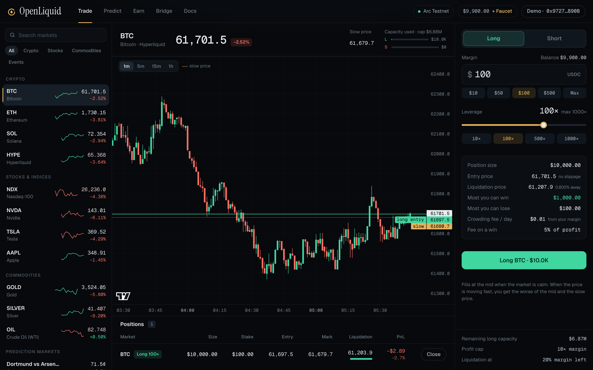
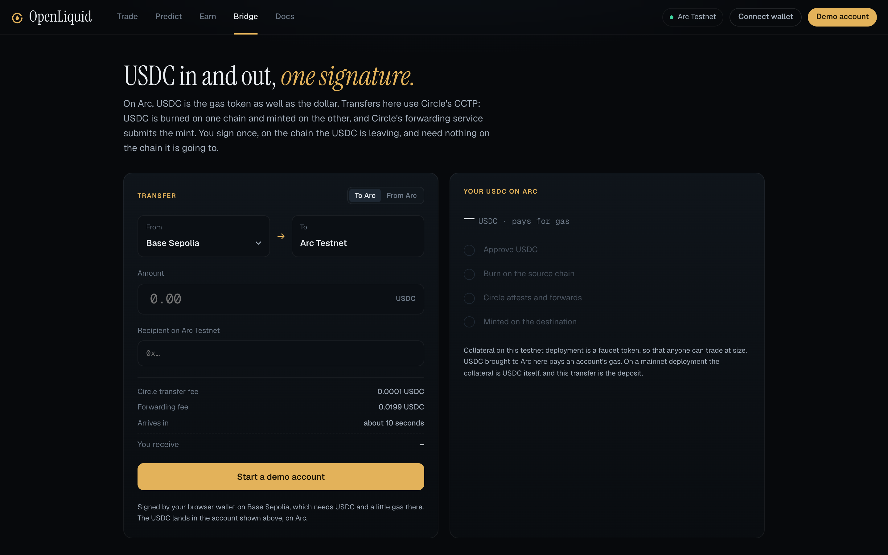

# OpenLiquid

**Trade anything with a price, at one price. No order book and no slippage in a calm market, up
to 1000× on crypto, stocks and commodities, and leverage on live prediction markets. On Arc.**
A winner is always paid in full when they close.


| | |
|---|---|
| **Hackathon** | University Blockchain Conference 2026 |
| **Main track** | DeFi and Onchain Applications |
| **Chain award** | Best use of Arc |
| **Bounty** | Gemini Prediction Markets |
| **Circle tools** | CCTP V2 with the Forwarding Service, for USDC in and out of Arc ([details](#circle-tools)) |
| **Live app** | **[pramay2007.github.io/OpenLiquid](https://pramay2007.github.io/OpenLiquid/)**: open it, click **Demo account**, and trade. No wallet needed. |
| **Whitepaper** | [docs/whitepaper](docs/whitepaper/README.md), also readable inside the app |
| **Status** | Live and tradeable on Arc testnet ([addresses](#live-on-arc-testnet)). The price keeper is hosted on Render. Testnet prototype, unaudited, test USDC only. |

### Try it in a minute

1. Open [pramay2007.github.io/OpenLiquid](https://pramay2007.github.io/OpenLiquid/).
2. Click **Demo account**. The app creates a key in your browser, the keeper sends it gas, and
   10,000 test USDC arrives from the faucet.
3. Pick a market, choose a side and a leverage, and open a position.

The keeper runs on a free Render instance that sleeps when nobody is using the site. If prices
show as offline, wait up to a minute for it to wake. Its status is at
[openliquid-keeper.onrender.com/health](https://openliquid-keeper.onrender.com/health).

**Contents:** [What it is](#what-it-is) · [The price-push test](#the-price-push-test) ·
[Architecture](#architecture) · [Live on Arc](#live-on-arc-testnet) · [Circle tools](#circle-tools) ·
[Gemini Prediction Markets](#how-it-uses-gemini-prediction-markets) ·
[Economic design and risks](#economic-design-and-risk-assumptions) · [Keeper](#keeper-decision-loop-and-limits) ·
[Run it](#run-it-locally) · [Host it](#host-it) · [Where each requirement is met](#where-each-requirement-is-met)

## What it is

**One price.** On an order book the price you see is not the price you get: there is a spread,
the book thins when the market moves, and a larger order fills worse. OpenLiquid has no book.
Every trade fills at a single price taken from the deepest market for that asset.

**Leverage up to 1000×.** A small account can take a real position: $10 controls $10,000 for a
short move. With one price and no book to walk, the leverage on the screen is the leverage you
get.

**Anything with a price.** Crypto, stocks, commodities, and prediction markets, which until now
have had no leverage at all.

A venue that fills at a price from somewhere else has one obvious weakness: anyone who can move
that price for a moment can trade against the move. The rules below are what make one price safe
to offer.



| The problem with filling at an outside price | OpenLiquid's rule |
|---|---|
| A briefly pushed reference price can be traded against | **Worse-of fills.** Buys fill at `max(mid, slow)`, sells at `min(mid, slow)`, where `slow` is a time-weighted price that only moves as a price is held. Calm market: the two are equal, zero slippage. |
| Size is unlimited relative to the real book | **Depth-backed capacity.** Open interest per side ≤ κ × USD resting near the mid on the reference venue, as reported with every price. |
| Winners may not get paid if the pool is short | **Reserved payouts.** A pre-funded vault locks each position's maximum profit when it opens. LPs cannot withdraw locked funds. Winners are paid at close. |
| The pool ends up with a one-way bet | **Skew funding.** The crowded side pays, scaled by skew relative to capacity. |
| A 1000× order can open already near liquidation in a fast market | **Entry guard.** An open is refused if its fill would start more than 30% of margin under water, which lowers usable leverage while the price is moving. |
| A token minted for trading can be farmed by trading against yourself | **Fee-minted token.** OLQ is minted only against fees paid, on a decaying curve with a hard cap. Stakers earn a share of fees. Trader losses belong to the LPs who underwrite trader wins. |
| Liquidation forfeits the whole margin | Liquidation happens at 20% of margin left; what remains after the liquidator's reward is returned to the trader. |

### Prediction-market perpetuals

Listing a binary market on a perp engine unchanged does not work: prices tick in 1¢ steps, books
are thin, and the price jumps to 0 or 1 at resolution. Event markets here use their own rules:

- **A short is a long on NO.** PnL for a short is measured on `1 − price`, so a 1× position on
  either side is fully collateralised and can never lose more than it put in.
- **Tick-bounded leverage.** Maximum leverage keeps the zero-equity price at least two ticks from
  entry: `price / 0.02` for Yes, `(1 − price) / 0.02` for No. At 50¢ that is 25×, not 1000×.
- **Leverage compression.** The cap decays linearly to 1× over the last 24 hours before the
  outcome starts being decided (kickoff for a match, expiry otherwise). Positions above the cap
  can be force-closed by anyone at the normal close price, with no penalty.
- **Settlement.** When Gemini reports the contract settled, the keeper signs the final price and
  anyone can settle any position.
- Longer averaging (5 minutes), a wider profit fee (10%) and a borrow fee on the leveraged part.


## The price-push test

`contracts/test/exploit.test.js` runs a price-push attack against the engine configured both
ways: an attacker opens a position, spends about $52k pushing the reference price by 0.12%, and
closes into the push. The oracle reports the manipulated mid faithfully in both cases.

| Engine | Size the attacker could open | Attacker P&L, one leg | Cost of the move |
|---|---|---|---|
| Any size at the mid | $297.0M | **+$349,272** | ~$52,000 |
| OpenLiquid | $9.9M | **+$185** | ~$52,000 |
| OpenLiquid, push held for 60 s | $9.9M | +$7,135 | more than $52,000 |

The same figures are animated on the app's Mechanics page.


## Architecture

```
 Hyperliquid (bbo websocket, l2Book)      Gemini Prediction Markets (events, book, candles)
              \                                   /
               +----------- keeper/ -------------+        signs PriceUpdate (EIP-712):
               |  sign · serve · relay · upkeep  |        { marketId, price, depthUsd, timestamp, resolved }
               +---------------------------------+
                  | HTTP /prices /stream             | oracle.push, liquidate, forceClose, close
                  v                                  v
              web/ (React + viem)  ---- open / close (carries a fresh signed price) ---->  Arc
                                                                                            |
        PriceOracle  ->  PerpEngine  ->  Vault (ERC-4626, USDC)                             |
                              |-> OpenLiquidToken (OLQ, minted on fees)                       |
                              '-> Staking (OLQ -> USDC fee share)  <-----------------------+
```

| Path | What it is |
|---|---|
| `contracts/src/PriceOracle.sol` | Verifies signed updates, keeps `mid` and the `slow` price per market. Anyone can relay. |
| `contracts/src/PerpEngine.sol` | Positions, fills, caps, funding, liquidation, event-market rules, settlement. |
| `contracts/src/Vault.sol` | ERC-4626 USDC vault. Holds trader margin and the reserve for every open position; LP share price marks open positions at the oracle. |
| `contracts/src/OpenLiquidToken.sol`, `Staking.sol` | Fee-minted token and USDC fee distribution. |
| `keeper/` | Price signer, relayer, liquidation and settlement bot, small HTTP API for the frontend. |
| `web/` | Opening page, trading interface, Earn, Bridge (CCTP), Mechanics and the whitepaper reader. |
| `docs/whitepaper/` | The whitepaper, as Markdown. The app renders the same files. |
| `markets.json` | Listed markets. `npm run pick-events` fills in live Gemini contracts. |

### Live on Arc testnet

Chain ID `5042002`, RPC `https://rpc.testnet.arc.io`. Deployed 2026-11-15 with Hardhat.

| Contract | Address |
|---|---|
| PerpEngine | [`0xa7c418e3A57292F59eCB554191D2906cd0Cd44e8`](https://explorer.testnet.arc.io/address/0xa7c418e3A57292F59eCB554191D2906cd0Cd44e8) |
| Vault (ERC-4626) | [`0x2b32560890De4070A66b47fD4242F2b817FBEF58`](https://explorer.testnet.arc.io/address/0x2b32560890De4070A66b47fD4242F2b817FBEF58) |
| PriceOracle | [`0xbF48c715F8816649D7D56AC01e5ae19850Ae517a`](https://explorer.testnet.arc.io/address/0xbF48c715F8816649D7D56AC01e5ae19850Ae517a) |
| OpenLiquidToken (OLQ) | [`0x0C1221ee07A921B078391512acb8fD1dCE72E6C3`](https://explorer.testnet.arc.io/address/0x0C1221ee07A921B078391512acb8fD1dCE72E6C3) |
| Staking | [`0xb0FaFD344dE5d451638B7711206e6A3Df0902f06`](https://explorer.testnet.arc.io/address/0xb0FaFD344dE5d451638B7711206e6A3Df0902f06) |
| Test USDC (collateral, open faucet) | [`0xE4475D526B1f625C87b3B0C56C7548016d20BB72`](https://explorer.testnet.arc.io/address/0xE4475D526B1f625C87b3B0C56C7548016d20BB72) |
| Price signer and keeper | [`0xe386ABa1C3197D166130ec45566208b0A658F6d2`](https://explorer.testnet.arc.io/address/0xe386ABa1C3197D166130ec45566208b0A658F6d2) |

Also used: Arc's native USDC (`0x3600000000000000000000000000000000000000`) as the gas token, and
Multicall3 (`0xcA11bde05977b3631167028862bE2a173976CA11`) to batch the app's reads.
The same addresses, with the 15 listed markets, are in `deployments/arcTestnet.json`.

### How it uses Arc

- **Everything is in dollars.** USDC is the collateral, the unit every position is quoted and
  settled in, the LP asset, the fee asset stakers receive, and on Arc also the gas token. A
  trader never holds a second token to pay fees.
- **Fees are small and predictable.** Opening a position costs about 1.3 cents of USDC in gas and
  closing one about half a cent (measured on testnet at 25 gwei). The whole deployment (six contracts, 15 markets,
  vault seeding) cost about 0.3 USDC.
- **One-click trading without a wallet.** The demo account is a key held in the browser. The
  keeper sends it 0.2 USDC once, enough gas for about ten round trips, so a new user trades
  with no wallet prompt and no seed phrase.
- **USDC arrives from other chains as gas.** The Bridge page brings USDC to Arc with CCTP, and
  on Arc that USDC is what pays for transactions. See [Circle tools](#circle-tools).
- **Fast finality fits signed prices.** Each trade carries a signed price that is valid for only
  20 seconds, which leaves little room to choose a stale one. That is workable because a trade on
  Arc is final in about a second.
- **Standard EVM tooling.** Plain Solidity 0.8.24 built and deployed with Hardhat; viem in the
  app, ethers in the keeper.

The collateral in this deployment is a faucet test token with USDC's six decimals, so anyone can
get 10,000 to try the app without waiting on Circle's faucet. Setting `USDC_ADDRESS` before
deploying uses Arc's own USDC as collateral instead; the contracts are the same.

### What Arc's public RPC taught us

Three behaviours of the load-balanced public endpoint broke transactions until the app handled
them. All three are handled in `web/src/data/wallet.ts`.

- **Stale nonces.** A node that is a block behind reports a nonce that has already been used, so
  the second of two quick transactions is refused. The demo account counts its own nonces, and a
  refusal over a nonce is retried.
- **Tight gas estimates.** An estimate comes with about 1% to spare, and a lagging node estimates
  against old state: an order sent right after a close was quoted 420k gas where it needs 500k,
  and ran out. Every transaction is sent with 1.5 times the estimate plus 60k.
- **Pending-block time.** Gas for a new transaction is estimated against a pending block stamped
  12 seconds after the latest one. A signed price valid for 10 seconds therefore looked expired
  before the order was sent. The validity window is 20 seconds.

### Circle tools

**CCTP V2 with the Forwarding Service** is built into the app's Bridge page
(`web/src/data/bridge.ts`). It moves USDC between Arc and Base, Ethereum, Arbitrum, OP and
Avalanche testnets in one transaction:

1. The sender calls `depositForBurnWithHook` on Circle's `TokenMessengerV2` on the source chain,
   with the forwarding hook attached.
2. Circle attests the burn.
3. Circle's forwarding service submits the mint on the destination. The sender signs nothing
   there and needs no gas token there.

Fees are read live from Circle's API and shown before signing. No API key is involved. A transfer
out of Arc signs with the app's own account, including the wallet-less demo account; a transfer
into Arc is signed by a browser wallet on the source chain and can be sent to any Arc address.



Verified on testnet on 2026-11-15, from the demo account in the app: 0.10101 USDC burned on Arc
([transaction](https://explorer.testnet.arc.io/tx/0x18e24b6b14481b6a71dd2e4d0a9a09c518750da3f34fb0c34ec15db4ea5b25c9))
and minted on Base Sepolia by Circle about ten seconds later
([transaction](https://sepolia.basescan.org/tx/0x383e0f64bdec02e9667a14ec285d2587c26bf7a130cdb485fa672e32c1212a4f)).
The Arc-to-other-chain direction is the one tested end to end; the other direction uses the same
call with the chains swapped and has not been run with funds.

What is not integrated, and why:

- **Circle Wallets and Gas Station.** Both support Arc testnet, and both need a Circle Developer
  Console key. Passkey smart accounts with sponsored gas are the natural replacement for the demo
  account and the keeper's gas drip, and are next on the list.
- **Circle Paymaster.** It is not deployed on Arc. Gas there is already paid in USDC.

On this testnet deployment the trading collateral is a faucet token, so USDC bridged to Arc pays
an account's gas. With `USDC_ADDRESS` set at deployment the collateral is Arc's USDC and the same
transfer is the deposit.

### How it uses Gemini Prediction Markets

Gemini's prediction-market odds and order-book depth are brought on-chain: for each listed
contract the keeper signs the mid and the nearby depth and posts them to Arc, where they set the
price, the capacity and the settlement of a leveraged market. The app charts how each contract's
odds have moved and shows what moving them further would do to a position. All public
market-data endpoints, no API key:

- `GET /v1/prediction-markets/events` to discover active contracts and choose which to list
  (`keeper/src/pick-events.js`: resolves ≥ 6 days out, priced 20–80¢, spread ≤ 2 ticks, ranked by
  resting depth).
- `GET /v1/book/{instrumentSymbol}` every 4 s for the mid and the USD depth within five ticks,
  which sets each event market's price and capacity on-chain.
- `GET /v2/candles/{instrumentSymbol}/1hr` for chart history.
- `GET /v1/prediction-markets/events/{ticker}` to detect settlement (`resolutionSide`) and settle
  positions at 0 or 1.

## Economic design and risk assumptions

**Who is on the other side.** The vault. Traders' net PnL is the vault's, with the sign flipped.
LPs earn trader losses, funding from the crowded side, borrow fees and 70% of profit fees; they
pay trader wins. Stakers earn 30% of profit fees and carry no trading risk.

**Fees.** Nothing to open or close. 5% of profit on crypto, stocks and commodities, 10% on event
markets. Skew funding. A borrow fee on the leveraged part of event positions.

**Token (OLQ).** Minted only to a trader who pays a profit fee, at
`rate(F) = R0 · (H / (H + F))²` OLQ per dollar of fee, where `F` is all fees paid so far,
`R0 = 100` and `H = $1M`. The rate starts at 100 per dollar and decays; total supply can never
exceed `R0 · H` = 100M. Losing a trade mints nothing, so two wallets trading against each other
get no more OLQ per dollar of cost than anyone else. Staked OLQ receives 30% of profit fees in
USDC.


**Parameters in this build** (`contracts/scripts/deploy.js`):

| | Crypto | Stocks / commodities | Event markets |
|---|---|---|---|
| Max leverage | 1000× | 1000× | 50× before the tick and time limits |
| Slow-price averaging | 60 s | 120 s | 300 s |
| Capacity κ (× reference depth) | 0.5 | 0.5 | 2.0 |
| Depth band | ±10 bps on Hyperliquid | ±10 bps on Hyperliquid | ±5 ticks on Gemini |
| Opens paused when mid−slow gap exceeds | 20 bps | 25 bps | 5 points |
| Profit cap | 10× margin | 10× margin | 10× margin, or the contract's natural maximum |
| Liquidation | 20% of margin left | same | same |

**Assumptions these rest on, and what breaks if they fail:**

1. *Moving the reference price and holding it there costs more than it pays.* The slow price
   forces a push to be held for about the averaging time; the capacity limit bounds the size it
   can be held against. If a reference book is far thinner than the reported depth, or κ is set
   too high, this fails. κ = 2 on event markets is a demo setting for books with only a few
   hundred dollars near the mid; the 5-minute slow price is the main defence there.
2. *The keeper's price is honest and fresh.* One signer in this build. A dishonest or compromised
   signer can misprice every market. Production needs several independent signers and a median.
3. *Prices move continuously enough to liquidate.* Losses are capped at margin, so a gap through
   the liquidation price is a loss the vault does not collect. The profit cap bounds the matching
   win.
4. *Binary jumps.* An event market can jump to 0 or 1 on news before leverage has compressed. A
   leveraged Yes plus a leveraged No held through such a jump profits at the vault's expense. This
   is bounded by the profit cap, the capacity limit and the tick-bounded leverage, and priced by
   the borrow fee, but it is not eliminated. Holding 1× on both sides through resolution loses the
   fee (tested).
5. *Latency and price choice.* A trader may submit any signed price from the last 20 seconds that
   is newer than the one on-chain, so they can pick the best of those. Worse-of fills delay that
   gain on entry; on exit it is immediate. The window was cut from 60 seconds to 20 and the keeper
   posts any 5 bp move on-chain, which bounds it without removing it.

A review raised five specific objections (the averaging formula, the liquidation price, the
validity window, LP solvency, and the cost to informed traders). Each is answered in
[Objections and answers](docs/whitepaper/12-objections.md).

**Honest cost to traders.** In a trending market the mid and the slow price differ, and every fill
takes the worse one. At 100× a 3 bp gap costs about 3% of margin on entry; at 1000× it would be
30%, which is where the entry guard starts refusing. "No slippage" is true when the market is calm
and is not true when it is moving fast.

## Keeper: decision loop and limits

Every second (`keeper/src/index.js`):

1. Read reference prices: Hyperliquid best bid/offer by websocket, Gemini books by REST.
2. Sign one `PriceUpdate` per market with the mid and the nearby depth.
3. Serve the signed updates over HTTP, so a trade can carry its own fresh price.
4. Relay on-chain when a market's heartbeat is due or its price has moved enough. Locally that
   is every 3 s or 2 bps. On Arc each relay costs gas, so relays are batched into at most one
   transaction every 10 s, on a 5 bps move or a 120 s heartbeat, while someone has the app open
   or a position is live; otherwise at most one a minute, on a 15 bps move or a 30 minute
   heartbeat.
5. Scan open positions against the live price; liquidate, force-close or settle what is due. Each
   of those calls carries its own fresh signed price, so upkeep does not wait for a relay.

Limits on the keeper:

- Its key signs prices and sends permissionless calls. It has no admin role and holds no user funds.
- It never signs a price whose source is older than 15 s.
- It marks an event resolved only when Gemini reports the contract settled.
- It stops relaying if its gas balance falls below a floor.
- On test networks it drips a fixed amount of gas to new demo accounts: 0.2 USDC, once per
  address, at most 10 an hour.

On-chain limits it cannot override: signatures are checked against the signer set, timestamps
cannot be in the future or go backwards, prices expire, and a resolved market accepts no further
updates.

## Run it locally

Requires Node 20+.

```bash
npm run setup          # install contracts, keeper and web dependencies
npm test               # 30 contract tests, including the exploit replay
```

Then, each in its own terminal:

```bash
npm run chain          # local Hardhat chain
```

```bash
npm run deploy:local   # deploy, register markets, seed the vault with test USDC
```

```bash
npm run keeper         # live prices from Hyperliquid and Gemini
```

```bash
npm run web            # http://localhost:5173
```

Click **Demo account**: the app creates a throwaway key in the browser, gets gas from the keeper
and 10,000 test USDC from the faucet, and trades with one click and no wallet prompts.

To refresh the listed prediction markets before deploying: `npm run pick-events`.

To watch the keeper liquidate, with the chain and keeper running:
`npm --prefix contracts exec -- hardhat run scripts/smoke-liquidation.js --network localhost`
opens a 1000× long and short on BTC and waits for the keeper to liquidate whichever the market
moves against.

## Deploy to Arc testnet

1. Copy `.env.example` to `.env` and set `DEPLOYER_PRIVATE_KEY`, `KEEPER_PRIVATE_KEY` and
   `KEEPER_ADDRESS`. Fund both addresses with testnet USDC from the
   [Circle faucet](https://faucet.circle.com/) (USDC is the gas token).
2. `npm run deploy:arc`
3. `NETWORK=arcTestnet npm run keeper`
4. `VITE_NETWORK=arcTestnet npm run web`

Leave `USDC_ADDRESS` unset to deploy a faucet test token as collateral (anyone can try the app
without waiting on the faucet), or set it to Arc's USDC to use the real testnet asset.

The app also takes deep links: `#m/101` opens market 101; `#earn`, `#bridge` and `#mechanics`
open those pages; `#docs/pricing` opens a whitepaper page.

## Host it

The public deployment is two pieces, and both are live: the app at
[pramay2007.github.io/OpenLiquid](https://pramay2007.github.io/OpenLiquid/) and the keeper at
`https://openliquid-keeper.onrender.com`. Trading on the public site was verified on 2026-11-15
with a fresh demo account: account setup, then two positions opened and closed.

**Web app, on GitHub Pages.** `npm run publish:web` builds the app against the Arc testnet
deployment and pushes it to the `gh-pages` branch. Set `VITE_KEEPER_URL` first if the keeper is
not at the default address.

**Keeper, on any Node host.** `render.yaml` is a Render blueprint for it: create the service from
this repository, and enter `KEEPER_PRIVATE_KEY` when asked. It needs nothing else, because the
deployment file and the ABIs it reads are in the repository. The key signs prices and pays the
keeper's gas, so its address needs testnet USDC from the [Circle faucet](https://faucet.circle.com/).
On a free instance the keeper sleeps when nobody has the app open; positions are not liquidated
while it sleeps, which is acceptable on a testnet and not anywhere else.

## Tests

```
PerpEngine: crypto / equity / commodity markets   14 passing
PriceOracle                                         3 passing
PerpEngine: event (prediction) markets              7 passing
Replay: the reference-price push attack              6 passing
```

## Where each requirement is met

| Requirement | Where |
|---|---|
| DeFi track: interacts with smart contracts | `contracts/src/`, deployed on Arc testnet |
| DeFi track: economic design and risk assumptions | [Economic design and risk assumptions](#economic-design-and-risk-assumptions) |
| DeFi track: contract addresses | [Live on Arc testnet](#live-on-arc-testnet) |
| Arc: core on-chain functionality on Arc | All positions, the vault, the oracle and the token live on Arc testnet |
| Arc: addresses and how the project uses Arc | [Live on Arc testnet](#live-on-arc-testnet), [How it uses Arc](#how-it-uses-arc) |
| Arc: Circle tools | [Circle tools](#circle-tools): CCTP V2 and the Forwarding Service, `web/src/data/bridge.ts` |
| Working demo | [pramay2007.github.io/OpenLiquid](https://pramay2007.github.io/OpenLiquid/), [Host it](#host-it) |
| Mechanics, in full | [Whitepaper](docs/whitepaper/README.md) |
| Gemini bounty: uses the Prediction Markets API | [How it uses Gemini Prediction Markets](#how-it-uses-gemini-prediction-markets), `keeper/src/sources/gemini.js`, `keeper/src/pick-events.js` |
| Architecture overview | [Architecture](#architecture) |
| Setup instructions | [Run it locally](#run-it-locally), [Deploy to Arc testnet](#deploy-to-arc-testnet) |

## What we would build next

- Several independent price signers with a median, and a second reference venue per market.
- Arc's own USDC as the only collateral, so a CCTP transfer is a deposit.
- Circle Wallets passkey accounts with Gas Station in place of the demo key and the gas drip.
- Leverage that compresses outside the underlying's trading hours for stocks and commodities,
  when reference books are thinnest.
- Hedging the vault's net exposure on the reference venues (Hyperliquid, Gemini's trading API).
- Jump-aware margin for event markets, so the borrow fee tracks how close resolution is.
- Partial closes, limit and stop orders, an audit.

## Credits

Charts: [Lightweight Charts](https://www.tradingview.com/lightweight-charts/) by TradingView.
Reference prices: Hyperliquid and Gemini public APIs. Contracts use OpenZeppelin.
